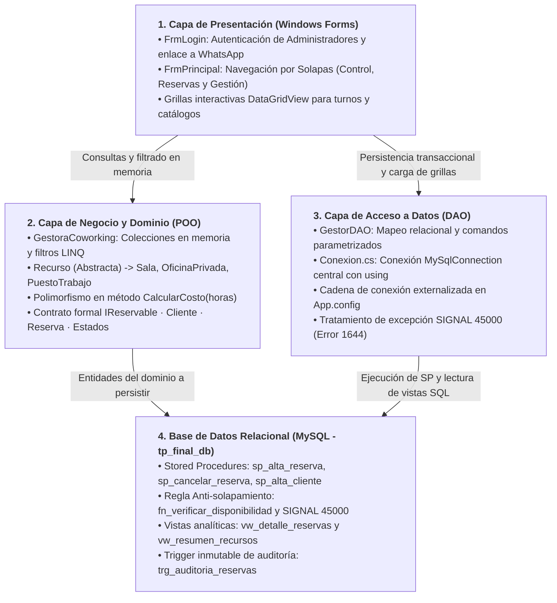

# Sistema de Gestión de Coworking y Reservas

<p align="left">
  
</p>

Trabajo Práctico Final Integrador de Algoritmos II  
**Carrera:** Analista de Sistemas de Información  
**Institución:** Instituto Argentino de la Empresa  
**Profesor:** Lic. Adrián Aroca  
**Ciclo Lectivo:** 2026  

**Desarrolladores (Grupo 2):**  
- Jonathan Lester Tullo (shonimdp@gmail.com)  
- David Samuel Ortega (davidortegaa86@gmail.com)  
- Maximiliano Scollo (maximilianoscollo17@gmail.com)  

---

## Descripción del Proyecto

Aplicación de escritorio corporativa desarrollada en **C# (.NET Framework 4.7.2)** con interfaz gráfica en **Windows Forms**, conectada de forma centralizada a un motor de base de datos relacional **MySQL / MariaDB (XAMPP)**, diseñada bajo las normas institucionales y pautas académicas de la cátedra.

El sistema administra integralmente las operaciones de un espacio de trabajo colaborativo (**Coworking**):

1. **Gestión de Clientes:** Padrón de clientes registrados con validación de datos de contacto.
2. **Catálogo Polimórfico de Recursos:** Administración de espacios físicos especializados (`Sala`, `OficinaPrivada`, `PuestoTrabajo`) que heredan de una clase abstracta base `Recurso` e implementan la interfaz `IReservable`.
3. **Cálculo Dinámico de Costos:** Sobrescritura polimórfica del método `CalcularCosto(horas)` en cada tipo de recurso, aplicando tarifas base y recargos por comodidades y mobiliario.
4. **Control Estricto de Concurrencia y Solapamiento:** Registro transaccional de reservas mediante Procedimientos Almacenados en MySQL. Si un recurso se encuentra ocupado en el rango horario solicitado, la base de datos aborta la transacción emitiendo `SIGNAL SQLSTATE '45000'`, el cual es capturado y tratado de forma amigable por la aplicación mediante `MySqlException`.
5. **Auditoría Automática:** Trigger en base de datos (`trg_auditoria_reservas`) que registra de forma transparente e inmutable cada cancelación de turnos.
6. **Consultas en Memoria e Intercambio de Datos:** Filtrado avanzado de reservas mediante expresiones **LINQ** en la capa gestora y serialización **JSON** para exportación/importación de registros.

---

## Arquitectura del Sistema

El software adopta una **arquitectura en capas** con separación estricta de responsabilidades (SoC), desacoplando la interfaz visual, la lógica de negocio en memoria, el acceso a datos y el motor relacional:



---

## Cómo usar / Instalación

### 1. Clonar el repositorio

Clonar con HTTPS:
```bash
git clone https://github.com/Rax0r-cmd/Trabajo_final_algoritmos.git
```

Clonar con SSH:
```bash
git clone git@github.com:Rax0r-cmd/Trabajo_final_algoritmos.git
```

### 2. Base de Datos (MySQL bajo XAMPP)

1. Iniciar el panel de control de **XAMPP** y encender el servicio **MySQL** (puerto predeterminado `3306`).
2. Abrir **phpMyAdmin** (`http://localhost/phpmyadmin`) o **MySQL Workbench**.
3. Abrir y ejecutar el script completo ubicado en:
   ```text
   DB/DB_TPFinal.sql
   ```
   Esto crea la base de datos `tp_final_db`, las 5 tablas normalizadas, las vistas analíticas, los procedimientos almacenados con control `SIGNAL 45000`, la función determinística de disponibilidad y el trigger de auditoría con datos de prueba.

### 3. Ejecutar la aplicación en Visual Studio

1. Abrir la solución en **Visual Studio 2022**:
   ```text
   SistemaDeGestion/SistemaDeGestion.slnx
   ```
2. Hacer clic derecho sobre la solución y seleccionar **Restaurar paquetes NuGet** para garantizar la vinculación de `MySql.Data`.
3. Seleccionar la configuración `Debug` / `AnyCPU` y presionar **F5** (o el botón *Iniciar*).
4. Para acceder a las funciones administrativas en `FrmLogin`, ingresar las credenciales autorizadas:
   - **Usuario:** `Admin`
   - **Contraseña:** `123456`

---

## Organización del Repositorio

```text
├── SistemaDeGestion/           (Código fuente y solución C# Windows Forms .NET Framework 4.7.2)
│   ├── Clases/                 (Modelos POO: Recurso, Sala, Oficina, Puesto, Cliente, Reserva, Gestora, GestorDAO, Conexion)
│   ├── Forms/                  (Formularios: FrmLogin, FrmPrincipal con solapas Control, Reservas y Gestión)
│   └── SistemaDeGestion.slnx   (Archivo de solución de Visual Studio 2022)
├── DB/                         (Persistencia relacional MySQL y diagramas de ingeniería)
│   ├── DB_TPFinal.sql          (Script SQL completo: tablas, vistas, SPs con SIGNAL 45000, función y trigger)
│   ├── Diagrama_DER.png        (Diagrama Entidad-Relación exportado de MySQL Workbench)
│   ├── Diagrama_Clases_UML.png (Diagrama de clases simplificado del dominio POO de alta legibilidad)
│   └── Diagrama_Editable.mwb   (Modelo editable de MySQL Workbench)
├── Documentacion/              (Documentación institucional y académica reglamentaria)
│   ├── TP_Final_AlgoritmosII_Grupo2.docx  (Documento Word integrador oficial según normas institucionales)
│   ├── TP_Final_AlgoritmosII_Grupo2.pdf   (Entregable único oficial maquetado en A4 - 23 páginas)
│   ├── Documentacion_Desarrollo.pdf       (Memoria técnica de POO, polimorfismo y capas)
│   ├── Diccionario_de_Datos.pdf           (Diccionario relacional de datos y objetos MySQL)
│   └── Manual_de_Usuario.pdf              (Guía de operación del sistema para usuario y administrador)
└── src/                        (Recursos gráficos institucionales: logos vectoriales, fondos e iconos)
```

---

## Tecnologías y Herramientas Utilizadas

- **Lenguaje de Programación:** C# (.NET Framework 4.7.2)
- **Interfaz de Usuario:** Windows Forms (WinForms)
- **Motor de Base de Datos:** MySQL / MariaDB (Entorno XAMPP v10.4+)
- **Acceso a Datos:** ADO.NET con MySQL Connector (`MySql.Data`) y Patrón DAO (`GestorDAO.cs`)
- **Herramienta de Modelado de Datos:** MySQL Workbench 8.0 CE
- **Entorno de Desarrollo:** Visual Studio 2022
- **Control de Versiones:** Git y GitHub
- **Normas de Presentación:** APA 7.ª edición y Pautas Institucionales del Instituto Argentino de la Empresa
