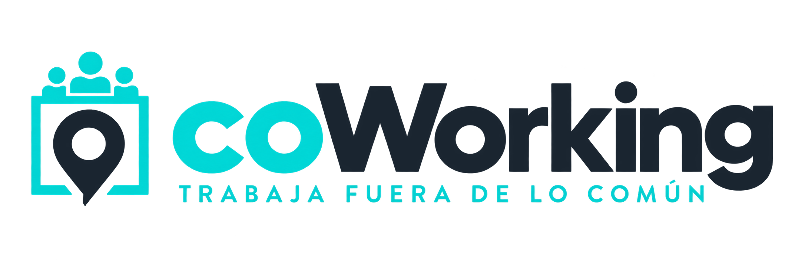
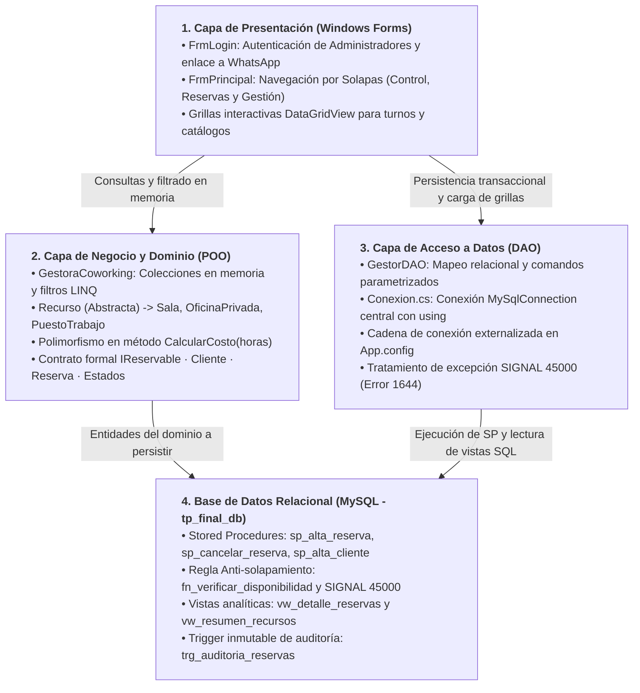

<p align="center">
  <picture>
    <source media="(prefers-color-scheme: dark)" srcset="src/Img/Logo/Logo_coWorking_con_lema_turquesa_y_blanco.png">
    <source media="(prefers-color-scheme: light)" srcset="src/Img/Logo/Logo_coWorking_para_fondo_blanco.png">
    
  </picture>
</p>

# Sistema de Gestión de Coworking y Reservas

<p align="left">
  
</p>

Trabajo Práctico Final Integrador de Algoritmos II  
**Carrera:** Analista de Sistemas de Información  
**Institución:** Instituto Argentino de la Empresa  
**Profesor:** Lic. Adrián Aroca  
**Ciclo Lectivo:** 2026  

**Desarrolladores (Grupo 2):**  
- Jonathan Lester Tullo (shonimdp@gmail.com)  
- David Samuel Ortega (davidortegaa86@gmail.com)  
- Maximiliano Scollo (maximilianoscollo17@gmail.com)  

---

## Descripción del Proyecto

Aplicación de escritorio corporativa desarrollada en **C# (.NET Framework 4.7.2)** con interfaz gráfica en **Windows Forms**, conectada de forma centralizada a un motor de base de datos relacional **MySQL / MariaDB (XAMPP)**, diseñada bajo las normas institucionales y pautas académicas de la cátedra.

El sistema administra integralmente las operaciones de un espacio de trabajo colaborativo (**Coworking**):

1. **Gestión de Clientes:** Padrón de clientes registrados con validación de datos de contacto.
2. **Catálogo Polimórfico de Recursos:** Administración de espacios físicos especializados (`Sala`, `OficinaPrivada`, `PuestoTrabajo`) que heredan de una clase abstracta base `Recurso` e implementan la interfaz `IReservable`.
3. **Cálculo Dinámico de Costos:** Sobrescritura polimórfica del método `CalcularCosto(horas)` en cada tipo de recurso, aplicando tarifas base y recargos por comodidades y mobiliario.
4. **Control Estricto de Concurrencia y Solapamiento:** Registro transaccional de reservas mediante Procedimientos Almacenados en MySQL. Si un recurso se encuentra ocupado en el rango horario solicitado, la base de datos aborta la transacción emitiendo `SIGNAL SQLSTATE '45000'`, el cual es capturado y tratado de forma amigable por la aplicación mediante `MySqlException`.
5. **Auditoría Automática:** Trigger en base de datos (`trg_auditoria_reservas`) que registra de forma transparente e inmutable cada cancelación de turnos.
6. **Consultas en Memoria e Intercambio de Datos:** Filtrado avanzado de reservas mediante expresiones **LINQ** en la capa gestora y serialización **JSON** para exportación/importación de registros.

---

## Arquitectura del Sistema

El software adopta una **arquitectura en capas** con separación estricta de responsabilidades (SoC), desacoplando la interfaz visual, la lógica de negocio en memoria, el acceso a datos y el motor relacional:



---

## Cómo usar / Instalación

El sistema ofrece dos modalidades de puesta en marcha:
1. **Opción A (Recomendada para usuarios o evaluación rápida):** Instalación directa mediante el asistente oficial de Windows Installer (`setup.exe`).
2. **Opción B (Para desarrolladores):** Compilación y ejecución desde el código fuente con Visual Studio 2022.

---

### Opción A: Instalación directa con el Instalador Oficial (Recomendada)

No se requiere tener instalado Visual Studio para probar la aplicación:

1. **Requisitos previos:**
   - Tener iniciado **MySQL** en el puerto `3306` (por ejemplo, encendiendo el servicio MySQL desde el panel de **XAMPP**).
   - Cargar la base de datos por única vez: abrir phpMyAdmin (`http://localhost/phpmyadmin`) o MySQL Workbench y ejecutar el script `DB/DB_TPFinal.sql`.

2. **Ejecutar el instalador:**
   - Ir a la carpeta `Instalador/` del repositorio (o la carpeta del instalador copiada en un pendrive).
   - Hacer doble clic en **`setup.exe`** (o en **`InstaladorCoWorking.msi`**).
   - Seguir los pasos del asistente de instalación de Visual Studio Installer ("Siguiente" $\rightarrow$ "Instalar").
   - El instalador creará automáticamente el acceso directo en el **Escritorio** y en el Menú Inicio.

3. **Credenciales de acceso:**
   - **Modo Cliente:** Acceso libre sin credenciales para consultar espacios y realizar reservas.
   - **Modo Administrador:** Menú superior $\rightarrow$ *Ingresar como Administrador*:
     - **Usuario:** `Admin`
     - **Contraseña:** `123456`

---

### Opción B: Ejecución desde el código fuente en Visual Studio

1. **Clonar el repositorio:**
   ```bash
   git clone https://github.com/Rax0r-cmd/Trabajo_final_algoritmos.git
   ```

2. **Inicializar la Base de Datos:**
   - Encender MySQL en **XAMPP** (puerto `3306`).
   - Importar y ejecutar el script ubicado en:
     ```text
     DB/DB_TPFinal.sql
     ```
     Esto creará la base `tp_final_db` con todas las tablas normalizadas, vistas, triggers y procedimientos con `SIGNAL 45000`.

3. **Abrir y compilar la solución:**
   - Abrir `SistemaDeGestion/SistemaDeGestion.sln` (o `.slnx`) en **Microsoft Visual Studio 2022**.
   - Restaurar paquetes NuGet (para vincular `MySql.Data`).
   - Seleccionar la configuración `Debug` o `Release` (`Any CPU`) y presionar **F5** (o botón *Iniciar*).

---

## Organización del Repositorio

```text
├── Instalador/                 (Paquete de distribución oficial de Visual Studio Installer)
│   ├── setup.exe               (Lanzador bootstrapper ejecutable con verificación de entorno)
│   └── InstaladorCoWorking.msi (Paquete Windows Installer estándar con la aplicación completa)
├── SistemaDeGestion/           (Código fuente y soluciones C# WinForms .NET Framework 4.7.2)
│   ├── SistemaDeGestion/       (Proyecto principal de la aplicación de escritorio)
│   │   ├── Modelos/            (Clases POO: Recurso, Sala, OficinaPrivada, PuestoTrabajo, Cliente, Reserva, RecursoFactory)
│   │   ├── DAO/                (Patrón DAO: ClienteDAO, RecursoDAO, ReservaDAO)
│   │   ├── Gestoras/           (GestorDAO, GestoraCoworking con LINQ y GestorJson para exportación/importación)
│   │   ├── ConexionDB/         (Conexion.cs con gestión centralizada MySqlConnection y using)
│   │   ├── Formularios/        (FrmPrincipal, FrmLogin y controles de navegación por pestañas)
│   │   ├── Enum/               (EstadoReserva.cs tipado: Pendiente, Confirmada, Cancelada)
│   │   └── App.config          (Cadena de conexión configurable a MySQL)
│   ├── SistemaDeGestion.sln    (Solución estándar de Microsoft Visual Studio 2022)
│   └── SistemaDeGestion.slnx   (Solución moderna XML de Visual Studio)
├── DB/                         (Persistencia relacional MySQL y diagramas de ingeniería)
│   ├── DB_TPFinal.sql          (Script SQL completo: tablas, vistas, SPs con SIGNAL 45000, función y trigger)
│   ├── Diagrama_DER.png        (Diagrama Entidad-Relación exportado de MySQL Workbench)
│   ├── Diagrama_Clases_UML.png (Diagrama de clases del dominio POO según rúbrica académica)
│   └── Diagrama_Editable.mwb   (Modelo editable en MySQL Workbench)
├── Manuales_Sistema/           (Manuales operativos integrados y accesibles desde la app)
│   ├── Manual_Usuario_Cliente.pdf (Guía de autogestión de turnos y catálogo para clientes)
│   └── Manual_Administrador.pdf   (Manual de gestión de clientes, recursos y reportes para admin)
├── Documentacion/              (Documentación institucional reglamentaria en DOCX y PDF)
│   ├── TP_Final_AlgoritmosII_Grupo2.pdf  (Informe integrador único maquetado en A4 - 22 páginas)
│   ├── Documentacion_Desarrollo.pdf      (Memoria técnica sobre POO, polimorfismo y capas)
│   ├── Diccionario_de_Datos.pdf          (Diccionario relacional de tablas y objetos MySQL)
│   └── Manual_de_Usuario.pdf             (Manual integral de usuario y administración)
├── Registro_de_cambios.txt     (Historial cronológico detallado de evoluciones y correcciones)
└── src/                        (Recursos gráficos: logotipos vectoriales, fondos e iconos)
```

---

## Tecnologías y Herramientas Utilizadas

- **Lenguaje de Programación:** C# (.NET Framework 4.7.2)
- **Interfaz de Usuario:** Windows Forms (WinForms)
- **Motor de Base de Datos:** MySQL / MariaDB (Entorno XAMPP v10.4+)
- **Acceso a Datos:** ADO.NET con MySQL Connector (`MySql.Data`) y Patrón DAO (`GestorDAO.cs`)
- **Herramienta de Modelado de Datos:** MySQL Workbench 8.0 CE
- **Entorno de Desarrollo:** Visual Studio 2022
- **Control de Versiones:** Git y GitHub
- **Normas de Presentación:** APA 7.ª edición y Pautas Institucionales del Instituto Argentino de la Empresa
